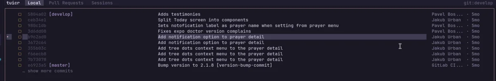
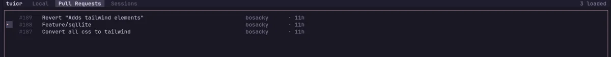
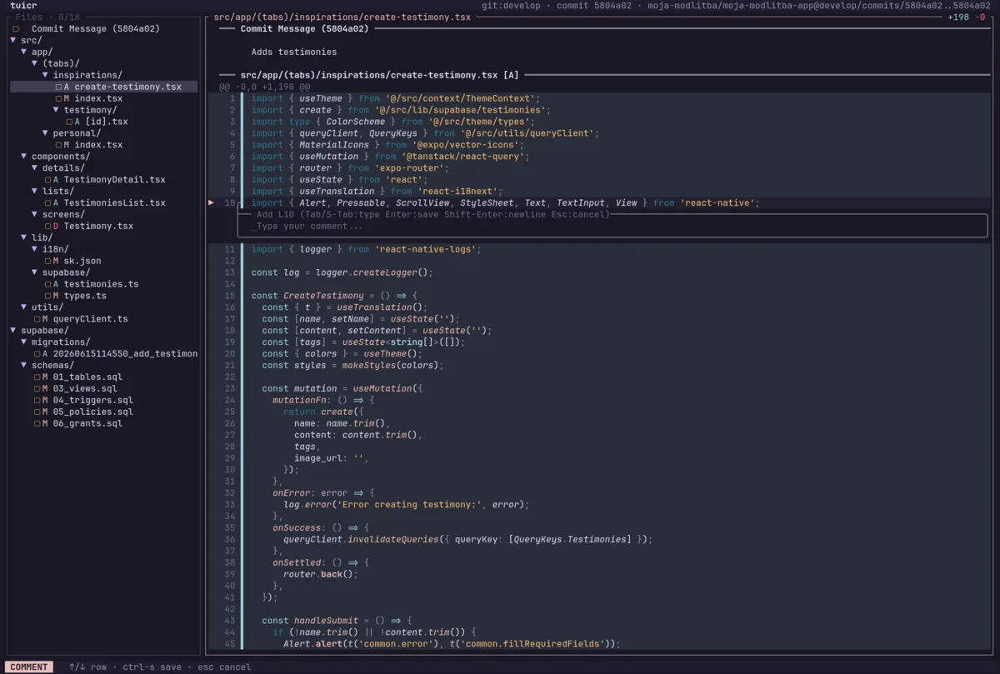
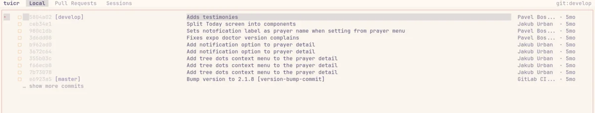
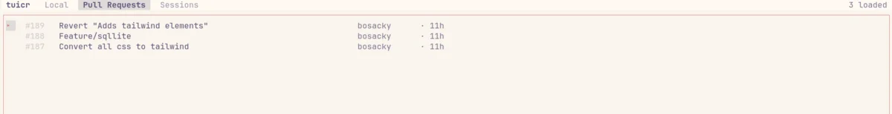
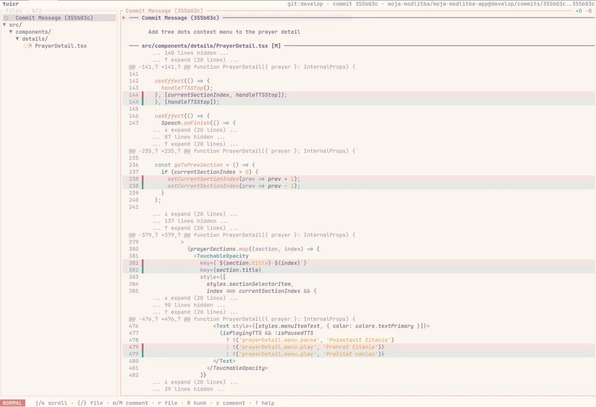

<p align="center">
    
    <h2 align="center">Rosé Pine for tuicr</h2>
</p>

<p align="center">All natural pine, faux fur and a bit of soho vibes for the classy minimalist</p>

## Usage

tuicr loads a local theme from its themes directory. The theme name is the file name without `.toml`.

| Platform | Theme directory |
| --- | --- |
| Linux / macOS | `~/.config/tuicr/themes/` |
| Windows | `%APPDATA%\tuicr\themes\` |

Copy one variant and the syntax theme with the same name. tuicr resolves `syntax_theme` relative to the `.toml` file, so the `.tmTheme` has to stay beside it.

```sh
mkdir -p "${XDG_CONFIG_HOME:-$HOME/.config}/tuicr/themes"
cp dist/rose-pine.toml dist/rose-pine.tmTheme "${XDG_CONFIG_HOME:-$HOME/.config}/tuicr/themes/"
```

Select it from the command line or from tuicr's config file:

```sh
tuicr --theme rose-pine
```

```toml
theme = "rose-pine"
```

Moon and Dawn use the same layout:

- `rose-pine-moon` with `rose-pine-moon.tmTheme`
- `rose-pine-dawn` with `rose-pine-dawn.tmTheme`

To follow the terminal appearance, pair a dark variant with Dawn:

```toml
theme_dark = "rose-pine"
theme_light = "rose-pine-dawn"
```

`rose-pine-moon` can be used as `theme_dark` instead.

## Gallery

### Rosé Pine

#### Local
<p align="center">
    <a href="https://github.com/rose-pine/rose-pine-theme">
      
  </a>
</p>

#### Pull Requests
<p align="center">
    <a href="https://github.com/rose-pine/rose-pine-theme">
      
  </a>
</p>

##### Code Review
<p align="center">
    <a href="https://github.com/rose-pine/rose-pine-theme">
      
  </a>
</p>


### Rosé Pine Dawn

#### Local
<p align="center">
    <a href="https://github.com/rose-pine/rose-pine-theme">
      
  </a>
</p>

#### Pull Requests
<p align="center">
    <a href="https://github.com/rose-pine/rose-pine-theme">
      
  </a>
</p>

##### Code Review
<p align="center">
    <a href="https://github.com/rose-pine/rose-pine-theme">
      
  </a>
</p>


## Thanks to

- [pavel](https://github.com/bosacky)
